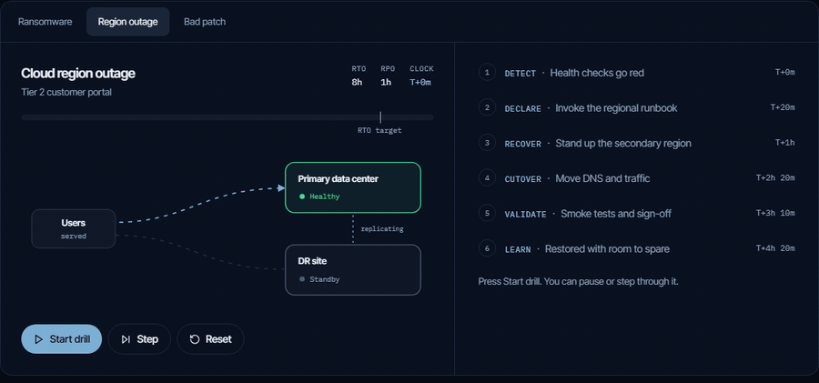
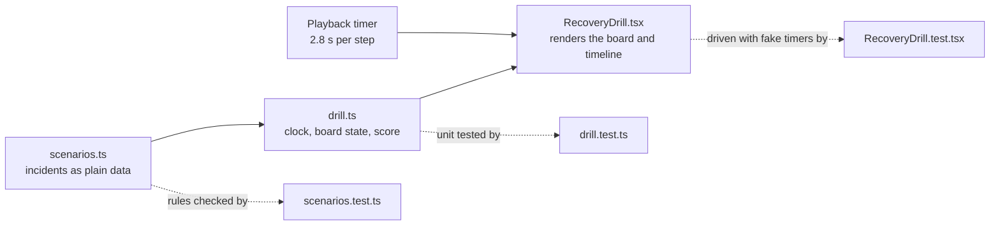

# recovery-drill

[](https://github.com/skycole/recovery-drill/actions/workflows/ci.yml)

A tabletop exercise trainer for disaster recovery. Pick an incident, then watch the recovery play out one step at a
time against its RTO and RPO targets: who declares, when replication gets cut, where the traffic goes, and when the
business signs off.



**Live:** [skycole.ai/#drill](https://www.skycole.ai/#drill)

## The three scenarios

Each one is a different kind of failure, with a different decision that matters most.

| Scenario | RTO | RPO | The decision that matters |
|---|---|---|---|
| Ransomware in the primary data center | 4h | 15m | Cut replication the moment you declare, so encrypted data does not follow you to DR. Then rebuild DR from immutable, known-clean backups, not from the replicas. |
| Cloud region outage | 8h | 1h | Do not wait on the provider's ETA while your own clock runs. DNS TTLs lowered ahead of time turn the cutover into minutes. |
| Bad patch pushed to the server fleet | 6h | 4h | Halt the remaining rollout rings first, fail over in business impact order, and afterwards fix the process (longer pilot soak, automatic halt on failed reboots). |

Every step carries a phase (Detect, Declare, Contain, Recover, Cutover, Validate, Learn), a T+ time, the state of
both sites, whether replication is running, and where users are being served from. The scenarios are generic,
public-knowledge practice, not any employer's plan.

## Running a tabletop with it

The drill works best when you do not let it play straight through.

1. Pick the scenario and read the targets out loud: tier, RTO, RPO.
2. Use **Step** instead of **Start**. Before each step, ask the room what they would do next and who owns it.
3. Reveal the step and compare. The clock bar shows how much of the RTO is already gone.
4. At the end, the drill scores the run: when the business signed off, against the RTO, and how much time was left.

## How it works



- [`src/data/scenarios.ts`](src/data/scenarios.ts) holds the incidents as data. Adding a scenario means adding one
  object; the data tests reject one that breaks the rules (time must move forward, one sign-off step, DR must be
  active before it serves traffic, and so on).
- [`src/lib/drill.ts`](src/lib/drill.ts) is pure logic with no React: the clock label, the board state at any step,
  the clock bar, and the score. The component only renders what these functions return.
- [`src/components/RecoveryDrill.tsx`](src/components/RecoveryDrill.tsx) holds the playback state (which scenario,
  which step, playing or paused) and draws the board as inline SVG.

**The scoring rule.** Service counts as restored when the business signs off (the Validate step), not when the last
step ends, because failback and lessons learned happen after users are already served. The RTO is met when sign-off
lands at or before the target. A run that misses gets its own verdict, with the overrun as the first item for the
lessons-learned report.

## Tests

40 tests, all passing:

| File | What it checks | Tests |
|---|---|---|
| `drill.test.ts` | Clock labels, playback timing, board state and replication rules, clock bar bounds, score (met, missed, on the line, no sign-off step) | 22 |
| `scenarios.test.ts` | Data rules for every scenario | 13 |
| `RecoveryDrill.test.tsx` | The component with fake timers: the clock runs step by step, pause holds it, Step and Reset, switching scenario stops the drill | 5 |

## Run it

Node 22 and pnpm:

```bash
pnpm install
pnpm dev
```

`pnpm test` runs the tests, `pnpm build` makes a static build in `dist/`.

React 19, Vite, Tailwind CSS 4, Framer Motion, Vitest and Testing Library. No backend, no storage, no analytics. The
only network request is the web font.

## Hosting and recovery design

[`docs/ARCHITECTURE.md`](docs/ARCHITECTURE.md) is a design for hosting this app on AWS and on Azure: recovery targets
per component, the failover path, who can change what, what the provider secures versus what I secure, and the tests
that would prove a recovery works. It is a design, not a deployment. The app itself is a static build with no backend.

## AI-built, human-directed

Built with AI coding agents. Sky designed it, directed it, reviewed it and verified it. The component was first built
for skycole.ai. For this repo, Claude (Anthropic) pulled the logic out into a pure module and wrote the tests.

How the work was controlled, because agents fail in predictable ways:

- **The agent does not grade its own work.** A separate review session that had not seen the code read the
  export cold, across this repo and its sibling exports, and reported 11 wording and accuracy issues. All 11 were
  fixed before publishing.
- **Claims are re-run, not remembered.** Every test count above was re-run on this exact code, and the scoring rule in
  the README is the one the tests check.
- **A gate in front of publishing.** Before anything left the machine it was scanned for credentials, local file
  paths, and personal or employer references, and the history was scanned again before the first push.
- **Logic and display are separate on purpose.** Pure functions hold the rules, so an agent can change the screen
  without being able to change how a run is scored, and the tests catch it if it tries.

## License

All rights reserved; see [`LICENSE`](LICENSE). You are welcome to read the code.
