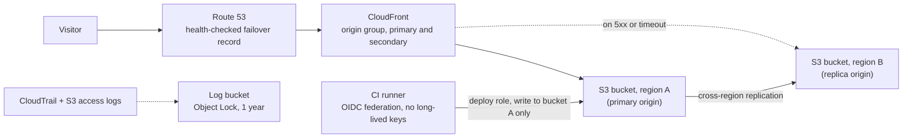
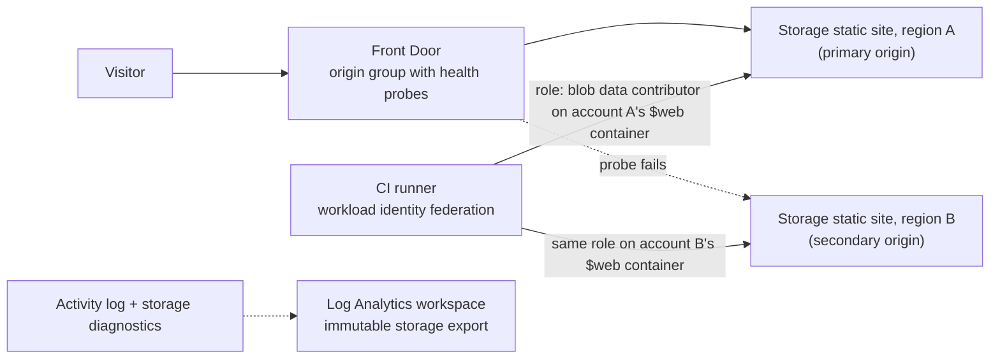

# Architecture and recovery design

This is a design document, not a deployment record. The app today is a static build served from a static host. Nothing here has been deployed to AWS or Azure. The point of the document is to show how I would host this app on either cloud, how it would fail over, who could change what, and how I would prove the recovery works to an auditor.

## 1. What the app is

A single-page app. No server, no database, no user accounts, no secrets, no cookies. Everything the visitor sees comes from files built once by CI.

| Part | What it is | Changes how often |
|---|---|---|
| Static assets | HTML, JS, CSS, one GIF | Each release |
| Scenario data | Plain data compiled into the JS bundle | Each release |
| Build pipeline | Install, typecheck, 40 tests, build | Each commit |
| DNS and TLS | One hostname, one certificate | Rarely |

Because there is no state, the recovery point is the last commit. Everything below is about the other half of the problem: how fast the site comes back, and who is allowed to change it.

## 2. Recovery targets per component

| Component | RPO | RTO | Why |
|---|---|---|---|
| Static assets, regional failure | 0 (rebuilt from the last commit) | 15 minutes | A second copy sits in a second region and is ready to serve |
| Static assets, bad or malicious release | Last known-good build | 30 minutes | Replication copies a bad release to the second region, so recovery is a rollback to a previous object version, not a failover |
| DNS | 0 | 5 minutes | Low TTL set ahead of time, health-checked failover record |
| Pipeline | 0 (config lives in the repo) | 4 hours | Runs again from the repo on another runner. The repo is itself a dependency, so a periodic bundle of it would be kept in the locked log bucket |
| Certificate | 0 | 1 hour | Reissued automatically, or a second certificate staged |

A tabletop with the drill in this repo practices the decisions behind these numbers: who declares, when traffic moves, who signs off.

## 3. On AWS

- **Failover:** CloudFront origin groups switch to the replica bucket on origin errors, so a regional bucket problem never reaches the visitor as a page error. Both buckets are private (Block Public Access on, CloudFront origin access control only). Route 53 and CloudFront are both global services, so this design does not cover a CloudFront-wide outage; covering that would need a second CDN in front of the replica bucket.
- **Bad release:** replication copies a bad deploy as fast as a good one. Both buckets keep versioning on, with a lifecycle rule that retains recent noncurrent versions, so a rollback restores the previous known-good objects.
- **Access:** the CI job assumes a role through OIDC federation. The trust policy only accepts the `main` branch of this repository, and the role can write to one bucket and nothing else. No human has standing write access; a break-glass role needs multi-factor sign-in and is alarmed on use.
- **Evidence:** CloudTrail records every role assumption, and with S3 data events turned on for both buckets, every write. Object Lock in compliance mode on the log bucket means the logs cannot be edited after the fact, and a deny rule on stopping or deleting the trail protects the trail itself.

## 4. On Azure

- **Failover:** Front Door probes both origins and routes around a failing one. The release job writes to both storage accounts so the secondary is never stale.
- **Access:** the pipeline uses a federated workload identity with one role assignment on each storage account's static site container, and nothing else. A compromised pipeline can therefore write to both copies, which is why the rollback steps in section 2 matter. People get read access through groups, and elevated roles are time-limited and approved.
- **Evidence:** the Activity log shows who changed the configuration, and the storage diagnostic logs record the blob writes. Both are exported to immutable storage.

## 5. Same design, two vocabularies

| Need | AWS | Azure |
|---|---|---|
| Edge, TLS, failover | CloudFront, ACM, origin groups | Front Door, managed certificate, origin groups |
| DNS failover | Route 53 health checks | Azure DNS with Traffic Manager or Front Door |
| Object storage with replica | S3 plus cross-region replication | Storage static site, second account, release to both |
| Keyless deploy | OIDC federation to an IAM role | Workload identity federation |
| Audit trail | CloudTrail | Activity log |
| Tamper-proof logs | S3 Object Lock | Immutable blob storage |
| Alerting | CloudWatch alarms | Azure Monitor alerts |

## 6. Who secures what

| Layer | Provider | Me |
|---|---|---|
| Physical data centers, hypervisor, storage durability | Yes | No |
| Edge network and managed service availability | Yes | No |
| Who has access to the account and the roles | No | Yes |
| What is in the bucket and what is published | No | Yes |
| The source repository: who can push, two-factor on the owner account, branch protection with no force pushes, actions pinned by commit | No | Yes |
| Replication and failover configuration | No | Yes |
| Proving a recovery works | No | Yes |

The provider promises the platform. The recovery is mine, which is why the test plan below exists.

## 7. How I would prove it works

| Test | Pass when | Evidence |
|---|---|---|
| Primary origin blocked | Site still serves from the replica within the RTO | Timestamps from the probe log |
| DNS failover fired by health check | Record flips with no manual step | Provider health history |
| Deploy role scope | Role cannot write to the replica or read anything else | Denied calls in the audit log |
| Break-glass role used | Alert fires, and the use is explained in a ticket | Alert plus ticket |
| Bad release pushed | Previous known-good version restored within the RTO | Version history and timestamps |
| Pipeline rebuilt from the repo on a clean runner | Same artifact hash on the same pinned toolchain | Build log |
| Log tamper attempt | Edit refused | Denied call in the audit log |

Each test is run as a drill: someone declares, someone runs the steps from a written runbook, someone signs off, and the result goes in an after-action note with owners and dates for what failed. The tabletop in this repo is the practice version of that loop.

## 8. What I would learn first

I have run recovery bridges and tracked failures to closure. I have not written infrastructure as code for these services. The first step on a real build would be a template for the replica origin and the deploy role, reviewed against the tests in section 7 before anything is published.
